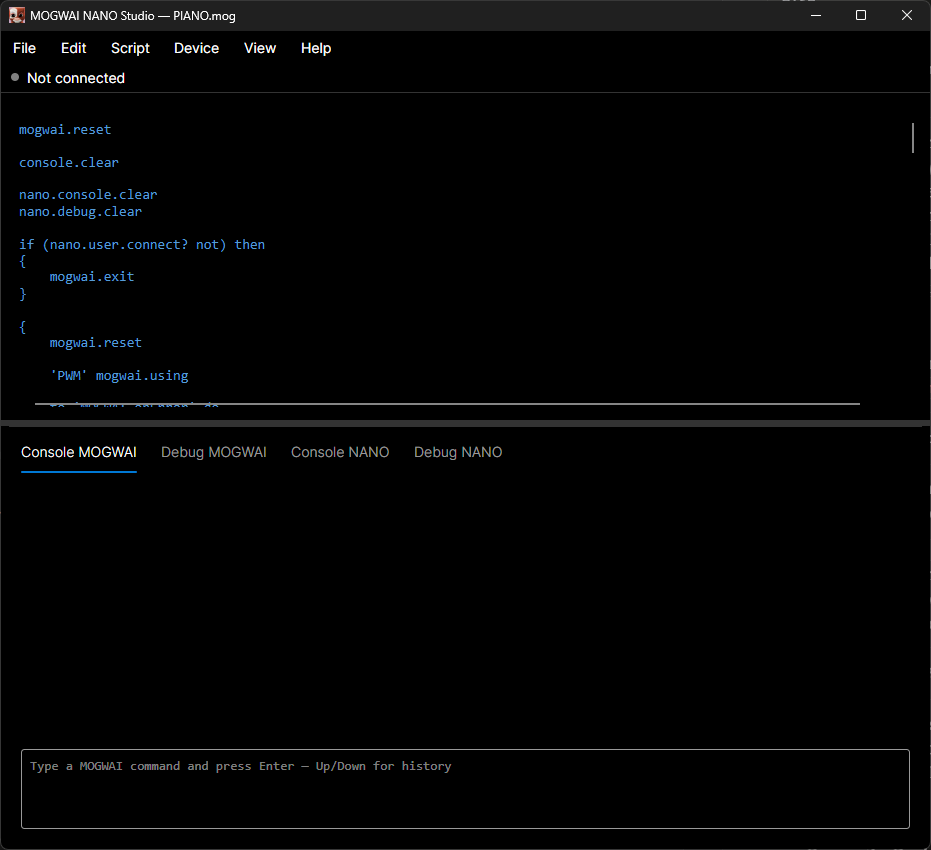

# MOGWAI NANO


## [MOGWAI](https://github.com/Sydney680928/mogwai) NANO - Scripting for Microcontrollers

[](LICENSE)
[](https://nanoframework.net/)

**Give your ESP32 a scripting engine.** MOGWAI NANO brings the [MOGWAI](https://github.com/Sydney680928/mogwai) engine to embedded devices — write comfortable, sugared code on your PC, and run it remotely on real hardware over WiFi.

> **Target hardware: an ESP32-S3 with PSRAM.** MOGWAI NANO is built and tested for microcontrollers with several megabytes of RAM available, and the ESP32-S3 with PSRAM is the only ESP32 it supports. A classic ESP32 (about 40KB of free RAM, no PSRAM) ran into real, measured limits — memory fragmentation under sustained load, and no practical room for [tasks](docs/device-primitives.md#5-tasks) — and is not a supported target. If you're picking hardware for this project, pick an ESP32-S3 with PSRAM. See [Memory considerations](#memory-considerations) below for the measurements behind this.

> If MOGWAI NANO looks useful to you, a ⭐ helps others discover it — thank you!

---

## What is MOGWAI NANO?

MOGWAI NANO is not a port of the desktop MOGWAI engine — it's a **companion runtime**, built from the ground up for the constraints of embedded devices. It works alongside **MOGWAI NANO Studio**, a desktop application that lets you write comfortable, sugared MOGWAI code, discover devices on your network, and run that code remotely on real hardware.

```
# What you write, comfortably, in MOGWAI NANO Studio
{
    if (a 10 >) then { "big" ? } else { "small" ? }
} nano.run
```

Behind the scenes, the code is **desugared** into pure canonical [RPN](https://en.wikipedia.org/wiki/Reverse_Polish_notation) before being sent to the device:

```
{ a 10 > } eval { "big" ? } { "small" ? } IFELSE
```

The device only ever executes this minimal form — no complex parser, no syntactic sugar to maintain twice. Just a tokenizer, a stack, and a primitive dispatcher, running in a few tens of kilobytes of RAM.

> **Note:** you never write the canonical form by hand. MOGWAI NANO Studio runs on the desktop MOGWAI engine, which only exposes sugared constructs (`if...then...else`, `for...do`, `while...do`, `forever do`, `timer...every...do`, `->`, etc.) to the developer — the underlying canonical primitives (`IF`, `IFELSE`, `FOR`, `WHILE`, `FOREVER`, `EVERY`, `AFTER`, `EVENT`, `STO`...) are private and generated automatically during desugaring, not meant to be typed directly.

## Why two runtimes?

- **MOGWAI NANO Studio** (PC) — full syntactic sugar, an integrated editor, network device discovery, and orchestration logic written in regular MOGWAI.
- **MOGWAI NANO** (device) — a minimal, rigorously disciplined RPN interpreter with GPIO, I2C (including a dedicated SSD1306 OLED display driver), SPI, PWM, ADC, BLE peripheral (ESP32 only), TFT colour displays and touch panels (ESP32 only), timers, event support, and real parallel execution via tasks.

This separation means the device firmware stays small and stable, while the desktop side can evolve freely — including reusing the existing [MOGWAI VS Code extension](https://github.com/Sydney680928/mogwai) with zero modification, since from the editor's point of view, you're just writing MOGWAI.

## Prerequisite: know a bit of MOGWAI first

MOGWAI NANO Studio runs on the desktop MOGWAI engine, and everything you write — including the code sent to a device via `nano.run` — is regular MOGWAI syntax (stack-based RPN, with syntactic sugar for control flow). If you've never used MOGWAI before, spend a few minutes with its documentation and tutorial first:

- [MOGWAI repository](https://github.com/Sydney680928/mogwai) — full documentation, tutorial, language reference
- [Try MOGWAI in your browser](https://github.com/Sydney680928/mogwai) — no install needed, a fast way to get a feel for the RPN style

Once you're comfortable with the basics of the language itself, the [Getting Started guide](docs/getting-started.md) below picks up from there and focuses on what's specific to NANO: connecting to a device, GPIO, timers, events, and the desugaring model.

## Key features

- **Full scripting language** — arithmetic, comparisons, control flow (`if...then...else`, `while...do`, `for...do`, `forever do`), user-defined functions, references (`&`), skills and flags, structured error handling (`trap`/`guard`)
- **Hardware support** — GPIO, I2C, SPI, PWM, ADC, BLE peripheral (ESP32 only), a dedicated SSD1306 OLED display driver, and — ESP32 only — SPI colour TFT displays (ST7789 built in, other controllers through a custom initialization table) with I2C capacitive touch panels (GT911, CST816, FT6x36), all configured from a single record
- **Tasks** — real parallel execution, each on its own native thread with a fully isolated runtime instance, communicating with the parent only through events. Practical only on a PSRAM-equipped board (~10KB per task) — see [Memory considerations](#memory-considerations)
- **Memory management** — a lazy-parsing execution model with two configurable modes (`mogwai.frugalMode`), trading CPU for a flat, predictable memory footprint on long-running or complex programs — a real constraint on devices with little RAM
- **Reusable code libraries** — *units*, stored on flash and loaded on demand, for sharing functions (an RTC helper library, for example) across scripts without copy-pasting
- **Integrated step-by-step debugger** — run a program in debug mode from MOGWAI NANO Studio and follow it instruction by instruction: the instruction about to run is highlighted in your original source, with Pause / Resume / Step controls, an optional trace delay, and the ability to run code in the console while paused to inspect or change variables and the stack. Parsing takes longer in debug mode, in exchange for being able to debug
- **Timers & stopwatches** — one-shot and recurring timers running independently of your main program, plus named stopwatches for measuring elapsed time
- **Events** — subscribe to hardware events (like GPIO changes) with data delivered through a `MOGRecord`
- **Network protocol** — UDP discovery + reliable TCP communication, with automatic disconnection detection and clean recovery
- **Persistent autorun** — store code to run automatically on every boot, for standalone production deployments
- **ESP32-S3 and Raspberry Pi Pico 2 W** — the runtime is built on a shared core plus per-platform pieces, with the ESP32-S3 fully usable end-to-end today; the Pico 2 W build is a minimal one, without the ESP32-specific features. It boots and runs the same runtime, but isn't yet usable with a Studio — see [Supported platforms](#supported-platforms) below

## Memory considerations

MOGWAI NANO needs memory headroom, which is why the ESP32-S3 with PSRAM is the target. Measurements on a classic ESP32, which gives MOGWAI NANO roughly 40KB of free RAM once the firmware and networking stack are up, showed two things that compound on a constrained platform:

- **Long-running programs are prone to memory fragmentation.** Programs that allocate and release many objects over time (loops, repeated function calls, string building) can end up with free memory scattered across many small fragments rather than one usable block — so a script can fail to allocate even when the total "free" figure looks comfortable, even after forcing a garbage collection.
- **Running several subsystems together compounds this quickly.** A display, I2C sensors, and sustained network traffic (Studio requests, background timers) all running in the same long session were measured to trigger real instability from this — not corrupted behavior, but outright allocation failures — well before the total memory looked exhausted.

None of this is a bug to "just fix" — it's a direct, measured consequence of running an interpreted RPN language on top of a managed CLR, on top of a real-time OS, on a few tens of kilobytes of RAM. **An ESP32-S3 board with PSRAM changes this picture completely.** With several megabytes available instead of tens of kilobytes, the same fragmentation risk is structurally still there, but never gets anywhere close to being a practical problem — a composite project (display + sensors + long network sessions) that showed real instability on a plain ESP32 ran rock-solid for hours straight on an ESP32-S3 with PSRAM in side-by-side testing, with no configuration changes to the script itself.

**Tasks (parallel execution) push this further still.** Each task costs roughly 10KB (its own engine instance plus its own native thread) — confirmed working smoothly on an ESP32-S3 with PSRAM, but confirmed genuinely too tight on a classic ESP32 (no PSRAM). To be precise about *why*: this isn't about the classic ESP32's Xtensa LX6 core being inherently incapable — it's specifically about PSRAM availability. This isn't a "might be an issue" caveat — it's a directly observed result. If your project needs tasks, a PSRAM-equipped board isn't optional.

**Recommendation:** use an ESP32-S3 with PSRAM, our validated path. As a rough, untested rule of thumb, at least 1MB of PSRAM should give the runtime enough breathing room — our own testing was done on boards with several megabytes available, so consider this an estimate rather than a validated minimum. We expect to refine this figure over time as the runtime evolves and its own memory footprint changes. See also `mogwai.frugalMode` above, which helps on constrained boards but doesn't eliminate this class of issue on its own.

## Supported platforms

| Platform | Status |
|---|---|
| ESP32-S3 (with PSRAM, `ESP32_S3_OCTAL`) | ✅ Tested — the supported ESP32 target, recommended for composite projects (display, multiple sensors, long-running sessions) |
| Raspberry Pi Pico 2 W (`PICO2_RP2350_W`, RP2350) | ⚠️ A minimal build of the runtime: the shared core plus GPIO, PWM, ADC, SSD1306 and date/time, without the ESP32-specific features (`esp32.setPinFunction`, the onboard LED, BLE peripheral, TFT and touch). It boots and runs, and deploys successfully — but WiFi doesn't currently connect (see note in [1b](#1b-flash-the-firmware--application-raspberry-pi-pico-2-w) below), so it can't yet talk to a Studio. Not usable end-to-end yet. About 250KB of RAM is left once the runtime is loaded, which is tight: expect small programs only. The original Pico W (RP2040) hasn't been tried |
| STM32 | 🔜 Should work — nanoFramework supports it, not yet tested by us |
| TI | 🔜 Should work — nanoFramework supports it, not yet tested by us |

A classic ESP32 is not a supported target: see [Memory considerations](#memory-considerations) for the measurements behind that choice.

### Tested display boards

The TFT and touch primitives ([TFT display](docs/device-primitives.md#19-tft-display), [Touch panel](docs/device-primitives.md#20-touch-panel)) are configured by a record, so they aren't tied to one board — these are the ones they have been validated on, both on an ESP32-S3 with PSRAM (`ESP32_S3_OCTAL`):

| Board | Display | Touch | Status |
|---|---|---|---|
| Waveshare ESP32-S3-Touch-LCD-2 | ST7789, 240×320 (SPI) | CST816D (I2C) | ✅ Tested — display and touch, in the four rotations |
| Waveshare ESP32-S3-Touch-LCD-7 | 800×480 RGB display (parallel RGB interface) | GT911 (I2C) | ⚠️ Touch panel tested (full area, multi-touch). The display isn't supported: the RGB interface isn't available |

Other ST7789 displays should work with the right size and rotation values; other SPI controllers can be described with a custom initialization table, and the FT6x36 and custom touch layouts are written but untried. We'd like to hear how it goes on other boards.

## MOGWAI NANO Studio

MOGWAI NANO Studio is the graphical companion app that talks to a device from your PC — built with [Avalonia](https://avaloniaui.net/): its own code editor, separate live console tabs for local and device output, file management, and light/dark themes, and a step-by-step debug panel (Pause / Resume / Step) that highlights the instruction being executed in your source. Download, run, no terminal required.



> An earlier console-based Studio existed up through the 0.5 release; it's no longer maintained as of 0.6.

## What's in a release

Every [release](https://github.com/Sydney680928/MogwaiNano/releases) attaches everything below — same version number across the board, since the whole ecosystem ships together:

- **`MogwaiNanoEsp32-<version>.bin`** — the device firmware/application for ESP32-S3. This is the file used in [Quick start](#quick-start) below, deployed with `nanoff --deploy --image MogwaiNanoEsp32-<version>.bin`.
- **`MogwaiNanoPicoW-<version>.bin`** — the minimal build of the runtime, without the ESP32-specific features, for Raspberry Pi Pico 2 W. Deploys successfully (see [1b](#1b-flash-the-firmware--application-raspberry-pi-pico-2-w) below), but isn't yet usable end-to-end — WiFi doesn't currently connect.
- **`mogwai-nano-studio-gui-<version>-<platform>.zip`/`.tar.gz`** — the Studio, self-contained, one archive per platform (`win-x64`, `linux-x64`, `linux-arm64`, `osx-x64`, `osx-arm64`). Pick the one matching your PC, extract, and run — no install, no .NET runtime required.

You only need one of the two firmware binaries — whichever matches your device — and only the Studio archive matching your platform. You don't need every file in a release, just the ones matching your situation.

## Quick start

### 1. Flash the firmware + application (ESP32-S3 with Octal PSRAM)

Download the latest `MogwaiNanoEsp32-<version>.bin` from the [Releases](../../releases) page, then:

```bash
# Install the nanoFramework flashing tool
dotnet tool install -g nanoff

# 1. Flash the firmware — be explicit about the target: nanoff cannot
# auto-detect Octal vs Quad PSRAM, and silently picking the wrong one
# will cause boot failures
nanoff --target ESP32_S3_OCTAL --serialport COMx --masserase --update

# 2. Power-cycle the board now — unplug, wait ~2 seconds, plug back in.
#    Required: deploying the application right after flashing the firmware,
#    without power-cycling in between, has been unreliable. Confirmed
#    consistently reliable with this power cycle in between.

# 3. Deploy the application — no explicit --address is needed here;
# confirmed across 4 different S3 boards
nanoff --target ESP32_S3_OCTAL --serialport COMx --deploy --image MogwaiNanoEsp32-<version>.bin
```

> **Known S3 quirk:** flashing can take several minutes rather than seconds — that is normal, not a sign of a hung process. Let it run.

> **Raspberry Pi Pico W:** the original (RP2040) hasn't been tried. For the Pico 2 W (RP2350), see [1b](#1b-flash-the-firmware--application-raspberry-pi-pico-2-w) below — it deploys, but isn't usable end-to-end yet.

> On ESP32, you may be asked to hold the BOOT/FLASH button on the board during flashing.

### 1b. Flash the firmware + application (Raspberry Pi Pico 2 W)

> **This target doesn't work end-to-end yet.** The steps below deploy successfully, but WiFi doesn't currently connect — the device boots and runs the runtime, but can't reach a Studio over the network, so there's no way to actually use it for anything yet. Configuring WiFi through Visual Studio's Device Explorer consistently freezes VS at the validation step; injecting a WiFi configuration programmatically instead does store the configuration (it's confirmed present on the device afterward), but the connection then fails anyway, with nothing pointing to whether that's a wrong configuration or a real connectivity problem. ESP32 devices on the same network connect without any issue. Documented here as a known limitation, not a guide to a working setup — we'll update this once it's resolved.

Confirmed working, for the Pico 2 W (`PICO2_RP2350_W`) specifically — the original Pico W (RP2040) hasn't been tried:

```bash
# 1. Flash the firmware
nanoff --platform rpi_pico --target PICO2_RP2350_W --update

# 2. Deploy the application
nanoff --target PICO2_RP2350_W --serialport COMx --deploy --image MogwaiNanoPicoW-<version>.bin
```

### 2. Configure WiFi

> **Recommended, not confirmed strictly necessary:** power-cycle the board again (unplug, wait ~2 seconds, plug back in) before this step, as a precaution — done as standard practice, without having isolated whether it's actually required here the way it is after flashing.

```bash
nanoff --networkdeployment wifi.json
```

with a `wifi.json` file:

```json
{
    "SerialPort": "COMx",
    "WirelessClient": {
        "Ssid": "YourNetworkName",
        "Password": "YourPassword"
    }
}
```

### 3. Run your first program

From MOGWAI NANO Studio's Console MOGWAI tab:

```
"192.168.1.75" nano.connect
{ 5 gpio.setMode.output forever do { 5 gpio.write.high 500 wait 5 gpio.write.low 500 wait } } nano.run
```

Not sure of your device's IP? Discover it on the network instead:

```
nano.user.select -> 'device'
if (device ->type .record ==) then { device->ip: nano.connect }
```

`nano.user.select` scans the network, lists the responding devices (platform and IP), and lets you pick one interactively — pushing `null` on the stack if you abort or nothing responds.

Your device is now blinking an LED, controlled remotely from your PC. 🎉

## Project structure

```
src/MogwaiNano/
├── runtime/
│   ├── MogwaiNanoCore/     # Platform-independent device runtime — engine, language, hardware primitives
│   ├── MogwaiNanoEsp32/    # ESP32 target: references Core + ESP32-specific pin configuration
│   └── MogwaiNanoPicoW/    # Raspberry Pi Pico 2 W target: references Core, minimal build without the ESP32-specific features (boots and runs; WiFi not yet working)
├── studio/
│   └── MogwaiNanoStudioGui/    # Desktop companion app, GUI (Avalonia)
└── usings/                 # Dynamically-loadable plugin libraries (experimental — see mogwai.using)
```

## Documentation

- [Getting started guide](docs/getting-started.md) — step-by-step NANO tutorial (connect, GPIO, timers, events)
- [Device primitives reference](docs/device-primitives.md) — complete, exhaustive reference for every primitive in the device runtime, marking which are shared with desktop MOGWAI and which are NANO-only
- [Studio primitives reference](docs/studio-primitives.md) — the full `nano.*` command set exposed by MOGWAI NANO Studio (connection, discovery, running and debugging code, device state, autorun)
- [ESP32 DeviceFunction values reference](docs/esp32-device-function-values.md) — the complete lookup table needed to use `esp32.setPinFunction` (SPI, I2C, serial, PWM, ADC, I2S, SDMMC)
- [Network protocol](docs/) *(coming soon)*

## Roadmap

- [x] I2C support
- [x] SSD1306 OLED display support (128x64, I2C Fast Mode)
- [x] TFT colour display and touch panel support (ESP32 only) — `tft.*` and `touch.*`, each in its own assembly, configured by a record. ST7789 built in and other SPI controllers through a custom initialization table; GT911 and CST816 touch controllers validated on real boards (Waveshare ESP32-S3-Touch-LCD-2 and -7), FT6x36 written but untried
- [x] PWM and ADC helper primitives — building on the same pattern already validated with I2C
- [x] SPI — `spi.open`/`close`/`write`/`transfer`, same by-name pattern as I2C/PWM/ADC. Validated against real hardware: a full MFRC522 RFID reader driver (register read/write, CRC coprocessor, card detection, UID/SAK retrieval) was written entirely in MOGWAI NANO script on top of it, with no additional C# needed
- [ ] `.binary`/`B:` support on NANO — for register-level bit manipulation
- [ ] STM32 and TI validation
- [x] ESP32-S3 / PSRAM validation — confirmed transparently usable by the managed heap, and confirmed to resolve the memory-fragmentation instability seen on plain ESP32 under sustained, multi-subsystem load (see [Memory considerations](#memory-considerations))
- [x] Tasks — real parallel execution, each on its own native thread with a fully isolated runtime instance (confirmed practical on ESP32-S3/PSRAM, confirmed too tight on a plain ESP32)
- [x] BLE peripheral support (ESP32 only) — a single record defines a whole peripheral (services, characteristics, properties, initial values). Lives in its own assembly, kept out of `MogwaiNanoCore` to stay well under its metadata-table size limit
- [ ] BLE central support (ESP32 only) — connecting to and interacting with other BLE peripherals from a MOGWAI NANO device
- [x] `.mog` library system ("units") — load reusable MOGWAI NANO code from flash at runtime (e.g. a shared RTC helper library)
- [ ] Dynamic PE loading for true runtime extensibility (nanoFramework already supports loading compiled assemblies dynamically, though it requires PSRAM) — a possible complement to the units system above on more capable boards
- [x] Restructure the runtime into a shared core plus per-platform pieces — `MogwaiNanoCore` (platform-independent) plus `MogwaiNanoEsp32`/`MogwaiNanoPicoW` (each referencing Core and adding only what's platform-specific). Each release now ships two separate, independently versioned firmware binaries
- [ ] Raspberry Pi Pico 2 W networking — the device boots and deploys successfully, but WiFi doesn't currently connect. Configuring it through Visual Studio's Device Explorer freezes VS at validation; injecting a configuration programmatically stores it correctly but the connection still fails, with no clear indication of why. Not yet usable with a Studio as a result
- [x] Integrated step-by-step debugger — `nano.debug`/`nano.debugall` run a program in debug mode, with the current instruction highlighted in the Studio editor and Pause / Resume / Step controls. Step-into only for now (no step-over or step-out), and not yet available for tasks or units
- [x] MOGWAI NANO Studio GUI, built on Avalonia — grew beyond the originally planned "monitoring only" scope into a genuinely capable companion: its own code editor, a REPL-style command line, live console/debug views, file management, and themes. VS Code + the MOGWAI extension remains a great way to write and edit code too — pick whichever fits your workflow

## About

MOGWAI NANO was born from an old idea: bringing [MOGWAI](https://github.com/Sydney680928/mogwai) to microcontrollers, using tools I already knew well. Read the full story on the blog: [MOGWAI Comes Down to Earth (and Silicon)](https://coding4phone.com/?p=2778).

Special thanks to [Laurent Ellerbach](https://github.com/Ellerbach), an active nanoFramework contributor, for his invaluable help throughout this project.

## Related projects

- [MOGWAI](https://github.com/Sydney680928/mogwai) — the desktop scripting engine
- [.NET nanoFramework](https://nanoframework.net/) — the .NET CLR for microcontrollers

## License

MOGWAI NANO is licensed under the [Apache License 2.0](LICENSE). See [NOTICE](NOTICE) for third-party attributions.
